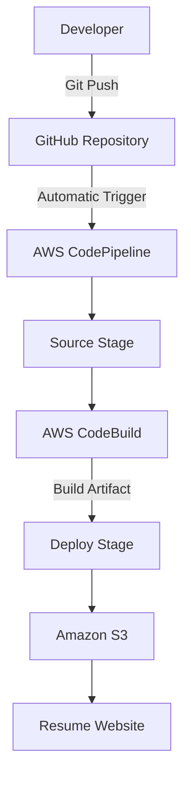

# AWS CI/CD Pipeline - Resume Website

## How to View This Documentation

This README contains the project overview, CI/CD pipeline
architecture, AWS configurations, setup instructions,
troubleshooting, and maintenance procedures.

### Recommended: View on GitHub

To view the complete documentation with the rendered
architecture diagram:

1. Open the GitHub repository:
   https://github.com/minkaze/aws-cicd-resume

2. Scroll down to the README section.

3. The Mermaid architecture diagram in Section 3
   will be displayed automatically.

No additional software or commands are required.

### Alternative: View Locally in VS Code

If viewing the README locally:

1. Open README.md in Visual Studio Code.
2. Press Ctrl + Shift + V to open Markdown Preview.
3. Alternatively, press Ctrl + Shift + P and search
   for "Markdown: Open Preview".

If the Mermaid diagram does not render in VS Code,
please use the GitHub version instead.

## 1. Project Overview

This project demonstrates a Continuous Integration and
Continuous Deployment (CI/CD) pipeline using AWS services.

The application is a personal resume website developed
using HTML, CSS, and JavaScript.

The pipeline automatically builds and deploys the website
to Amazon S3 whenever changes are pushed to the main
branch of the GitHub repository.

## 2. Technologies Used

- HTML5, CSS3, JavaScript
- Git and GitHub
- AWS CodePipeline
- AWS CodeBuild
- Amazon S3
- AWS IAM
- Amazon CloudWatch Logs

## 3. Pipeline Architecture



### Pipeline Workflow

1. Developer modifies the website locally.
2. Changes are committed and pushed to GitHub.
3. GitHub triggers AWS CodePipeline.
4. CodePipeline retrieves the source code.
5. AWS CodeBuild runs buildspec.yml.
6. CodeBuild validates and packages website files.
7. CodePipeline deploys the build artifact to S3.
8. The updated website becomes accessible through
   the S3 static website endpoint.

## 4. Project Structure

```text
aws-cicd-resume/
├── index.html
├── style.css
├── script.js
├── .gitignore
├── buildspec.yml
└── README.md
```

## 5. AWS Configuration

### AWS Region
us-west-2 (US West - Oregon)

### GitHub Repository
https://github.com/minkaze/aws-cicd-resume

### AWS CodePipeline
Pipeline name: resume-website-pipeline

Stages:
1. Source - GitHub
2. Build - AWS CodeBuild
3. Deploy - Amazon S3

### AWS CodeBuild
Project name: resume-website-build

Build configuration:
- Amazon Linux managed image
- Standard runtime
- buildspec.yml
- Build artifact containing website files

### Amazon S3
Bucket name: minh-aws-cicd-resume-2026

Static website hosting: Enabled

Index document: index.html

Deployment configuration:
- Input artifact: BuildArtifact
- Extract files before deployment: Enabled
- Deployment path: Bucket root

## 6. Build Process

The buildspec.yml file defines the build process.

The pipeline performs the following operations:

1. Checks that required website files exist.
2. Creates a dist directory.
3. Copies HTML, CSS, and JavaScript files.
4. Packages the dist directory as a build artifact.
5. Passes the artifact to the deployment stage.

No external dependencies are required because this
project uses plain HTML, CSS, and JavaScript.

## 7. Deployment Process

The deployment stage uses Amazon S3.

When CodeBuild completes successfully, CodePipeline
extracts the build artifact and uploads the website
files into the configured S3 bucket.

The S3 static website endpoint serves the website.

Note: The native S3 website endpoint uses HTTP.
This setup is intended for an educational demonstration.

## 8. Continuous Deployment Demonstration

To demonstrate automatic deployment:

1. Open index.html in Visual Studio Code.
2. Modify the homepage heading.
3. Save the changes.
4. Run the following commands:

```bash
git add .
git commit -m "Update resume website"
git push origin main
```

5. Open AWS CodePipeline.
6. Observe the new pipeline execution.
7. Verify that Source, Build, and Deploy succeed.
8. Refresh the public S3 website.
9. Confirm that the changes appear automatically.

## 9. Features Completed

- [x] Professional resume website
- [x] GitHub version control
- [x] .gitignore configuration
- [x] AWS S3 static website hosting
- [x] AWS CodePipeline
- [x] Automatic GitHub change detection
- [x] AWS CodeBuild integration
- [x] Build artifact packaging
- [x] Automatic S3 deployment
- [x] Basic file validation
- [x] CloudWatch build logging
- [x] Pipeline documentation

## 10. Features Not Implemented

- [ ] Separate automated testing stage
- [ ] Jest or Selenium automated tests
- [ ] CloudWatch alarms and notifications
- [ ] HTTPS with Amazon CloudFront

These features were not mandatory for the assignment.

## 11. Monitoring and Maintenance

### Pipeline Monitoring

1. Open AWS CodePipeline.
2. Select resume-website-pipeline.
3. Check the execution status of each stage.
4. Open failed actions to inspect error details.

### Build Logs

1. Open AWS CodeBuild.
2. Select resume-website-build.
3. Open Build history.
4. Select a build execution.
5. View CloudWatch logs.

### Updating the Website

Modify the website locally and push the changes
to the main branch.

CodePipeline automatically deploys the changes.

## 12. Troubleshooting

### Pipeline Does Not Start

Possible causes:
- Changes were pushed to the wrong branch.
- GitHub connection is not available.
- Automatic trigger is disabled.

Solution:
Verify the GitHub connection and pipeline trigger.

### Build Stage Fails

Possible causes:
- Missing buildspec.yml.
- Invalid YAML syntax.
- Missing website files.

Solution:
Check CodeBuild logs and verify buildspec.yml.

### Deploy Stage Fails

Possible causes:
- Incorrect S3 bucket configuration.
- Missing IAM permissions.
- Incorrect input artifact.

Solution:
Verify the deployment settings and IAM role.

### Website Does Not Update

Possible causes:
- Pipeline execution has not succeeded.
- Browser caching.
- Incorrect deployment bucket.

Solution:
Verify that Deploy succeeded and refresh the website.

### Access Denied (403)

Possible causes:
- Missing public read policy.
- S3 Block Public Access settings.
- Account-level public access restrictions.

Solution:
Review the website bucket policy and access settings.

## 13. Security Considerations

- IAM service roles are used for AWS services.
- GitHub access uses AWS CodeConnections.
- No AWS credentials are stored in the repository.
- The public S3 bucket contains only website files.
- Production websites should use HTTPS and private
  S3 storage with CloudFront.

## 14. AWS Resource Cleanup

After the assignment demonstration:

1. Delete the AWS CodePipeline pipeline.
2. Delete the AWS CodeBuild project.
3. Empty and delete the website S3 bucket.
4. Identify and remove unused pipeline artifact buckets.
5. Remove unused CloudWatch log groups.
6. Remove assignment-specific IAM roles.
7. Delete unused CodeConnections connections.
8. Verify the AWS Billing dashboard.

Deleting resources helps prevent ongoing AWS charges.

## 15. Conclusion

This project demonstrates how AWS CodePipeline,
CodeBuild, GitHub, and Amazon S3 can work together
to automate website deployment.

The pipeline reduces manual deployment work
and ensures that changes pushed to GitHub can
be automatically built and deployed to AWS.
